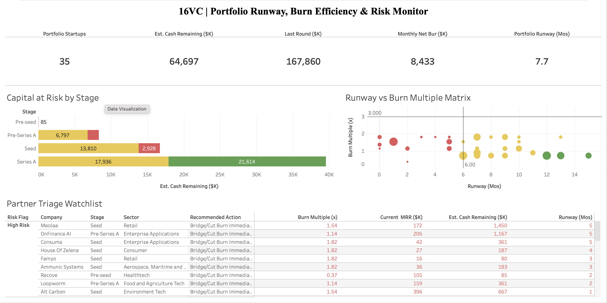

 Portfolio Runway, Burn Efficiency & Risk Monitor

An end-to-end venture capital portfolio monitoring pipeline combining **SQL deal exports**, a **dynamic Excel scenario & risk model**, and an **interactive Tableau Partner Dashboard** across 35 early-stage startups (Pre-Seed to Series A).

🔗 **[View Live Interactive Dashboard on Tableau Public](https://public.tableau.com/app/profile/abbishek.rajh/viz/16VCPortfolioRunwayBurnEfficiencyRiskMonitor/16VC_Portfolio_Dashboard)**

---

## Executive Portfolio Snapshot
* **Active Portfolio Companies:** 35 (Bengaluru & Indian early-stage ecosystem)
* **Total Capital Deployed:** $167,860K
* **Estimated Cash Remaining:** $64,697K
* **Aggregate Monthly Net Burn:** $8,433K
* **Weighted Portfolio Runway:** 7.7 Months
* **Current Risk Distribution:** **12 High Risk** (34%) • **19 Watch** (54%) • **4 Healthy** (11%)

---

## Analytical Framework & Risk Logic
Built around **Craft Ventures' Burn Multiple** framework (`Net Burn / Net New ARR`) to evaluate capital efficiency alongside cash survival:

| Risk Tier | Runway Threshold | Burn Multiple Threshold | MoM MRR Growth | Recommended Partner Action |
| :--- | :--- | :--- | :--- | :--- |
| **High Risk** | `< 6.0 Months` | `> 3.0x` | Any | Bridge / Cut Burn Immediately |
| **Watch** | `6.0 – 11.9 Months` | `1.8x – 3.0x` | `< 5.0%` | Prep Next Round / GTM Review |
| **Healthy** | `≥ 12.0 Months` | `≤ 1.8x` | `≥ 5.0%` | Scale & Follow-on Reserve |

---

## Repository Structure
* **`assets/dashboard_preview.png`** — Export of the 4-panel interactive Tableau Partner Dashboard.
* **`data/`** — Raw SQL deal, round, and MRR export (`.csv`).
* **`excel/`** — Three-tab dynamic portfolio workbook (`1_SQL_Deals`, `2_Assumptions`, and `3_Portfolio_Model`) automating Burn Multiple, Runway, Risk Flag (`IF/OR` logic), and Recommended Action triage.
